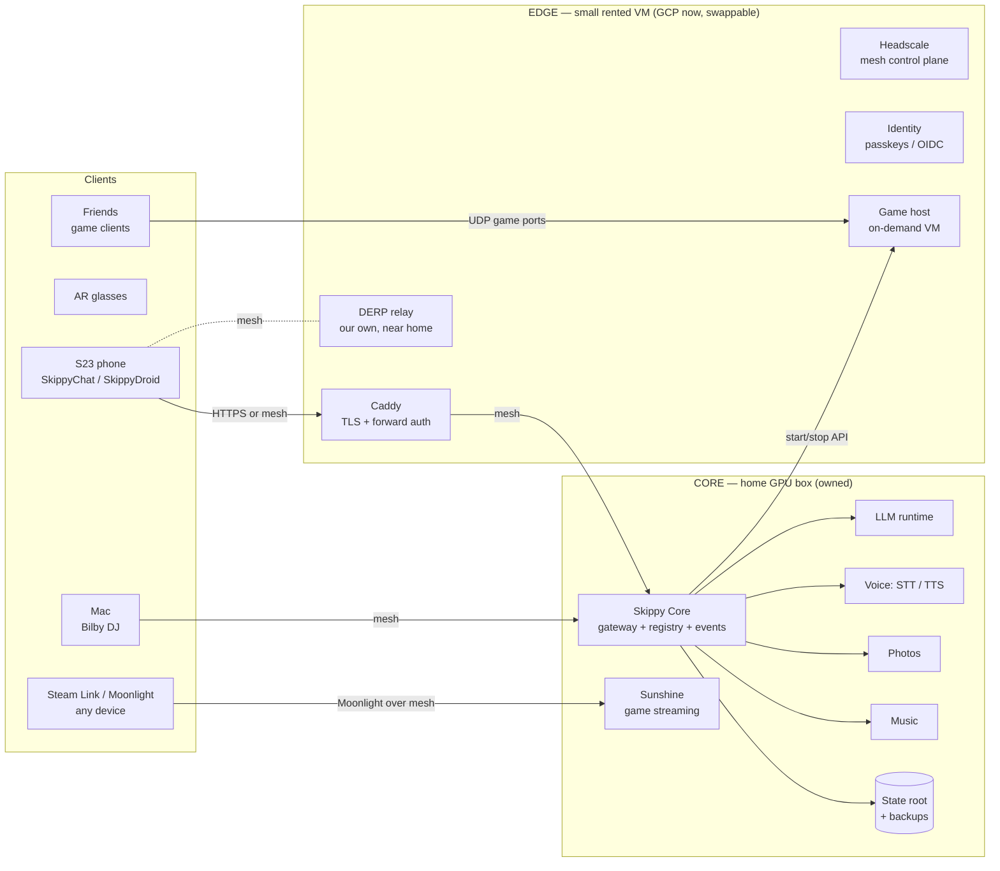

# SkippyTel 2.0 — Charter

**Status:** DRAFT 1 · 2026-09-28
**Supersedes:** `misc/SKIPPYTEL_BRIEF.md` (v1) once ratified by the Captain.
**v1 role:** first draft of intent. Everything in v1 is kept as *evidence of
what the Captain actually uses*, not as architecture we are bound to.

---

## 1. Mission

> **One personal service, owned end to end.** Skippy is the single front
> door to the Captain's compute, data, media, games, and AI — reachable
> from anywhere, fast, private by default, and dependent on rented public
> services only where renting is a conscious, reversible choice.

v1 grew organically: a Flask monolith with ~20 blueprints, host-side
scripts (claude-bridge, ups-monitor), state scattered across repos
(`../music-collection/state`, `D:/Aaron/Music`), Tailscale-as-auth, and
Google Drive as the photo store. It works — and it proved which
capabilities matter. v2 turns that pile into a coherent system.

## 2. Principles (the doctrine)

1. **Sovereignty ledger.** Every external dependency is listed in §7 with
   *why we rent it* and *how we'd leave*. Nothing rented is load-bearing
   without an exit plan. Default answer to "should we add a SaaS?" is no.
2. **Local first, cloud by consent.** Inference, voice, photos and
   music run on hardware the Captain owns. Cloud LLM tiers stay explicit
   opt-in phrases (v1 rule kept: no silent fallback that burns tokens or
   leaks data).
3. **Capabilities, not endpoints.** Everything Skippy can do is a
   *capability module* with a manifest (v1's `/services` idea, promoted to
   the organising principle). The core knows nothing about music or photos;
   it knows how to route, authenticate, discover, and observe modules.
4. **Reachable from anywhere, without trusting a third-party control
   plane.** Own the mesh (Headscale + our own DERP relay) and own the
   public front door (our edge node + our domain).
5. **Auth is real.** "The tailnet is the auth" ends the day anything is
   public. Every request carries an identity; dangerous capabilities
   (Claude Code with full permissions, game-server control, SMS) require
   elevated scope.
6. **Boring, swappable infrastructure.** Docker Compose + OpenTofu +
   plain Linux. No provider-specific services on the critical path, so
   the edge can move GCP → Hetzner → a closet box in an afternoon.
7. **Kept from v1:** `spec_version` in every response (now `"2"`), palette
   names never hex, no ellipsis / no scrollbars in HUD text, stateless
   phone-initiated requests, quarantine (clients and server share a
   written contract, never code), privacy posture (§8 of the v1 brief).

## 3. Topology

Three tiers, one private mesh.



| Tier | What lives there | Why there |
|---|---|---|
| **Core** (home) | Everything with a GPU or private data: LLMs, Whisper, TTS, photos, music, Sunshine, the state root. | Owned hardware, zero marginal cost, data never leaves. |
| **Edge** (rented, tiny) | Public front door (Caddy), identity, Headscale, our DERP relay, game-server control. Always on, ~1–2 vCPU. | Needs a public IP and uptime independent of the home PC. Holds **no private data** — only routes it. |
| **Burst** (rented, on-demand) | Dedicated game servers (Valheim, Factorio, ARK). Started by voice, auto-stopped when empty. | Friends need a stable public endpoint; paying per play-hour beats Nitrado's per-month-per-game. |

### Why this fixes the lag

The Tailscale lag is almost certainly phone traffic hairpinning through a
Tailscale-operated DERP relay (cellular CGNAT blocks direct paths). v2
runs **our own DERP on the edge**, in a region near home, so the relayed
path is short, and direct paths get a public STUN helper we control.
Phone clients that aren't on the mesh use plain HTTPS through Caddy.

## 4. Skippy Core (the v2 server)

Replaces the v1 Flask monolith. **Python 3.12 + FastAPI** (continuity with
v1 code and libraries; native async/SSE/WebSockets; OpenAPI generated for
free so the phone contract is machine-checked instead of hand-copied).

Core owns exactly five things:

1. **Gateway** — one API surface (`/v2/...`), request identity, scopes,
   rate limits, the response envelope.
2. **Registry** — capability manifests (static + self-registering, v1 §5
   semantics kept: TTL, heartbeat, override-on-collision), live health,
   voice triggers, HUD placement.
3. **Intent router** — text in → capability or LLM tier out. v1's regex
   interceptors (photos, music) become triggers declared *by the modules*,
   not hard-coded in `intent.py`.
4. **Event bus** — server → client push that survives partitions: SSE /
   WebSocket stream with resume cursor, plus self-hosted **ntfy** for
   phone notifications (replaces "not a push channel" v1 limitation).
5. **Resource arbiter** — the GPU is shared by LLMs, Whisper,
   Stable Diffusion *and* games/streaming. Core owns "game mode": evict
   models from VRAM when Sunshine or a local game starts, reload after.

Everything else is a **capability module**: its own container, its own
manifest, talks to Core over HTTP on the internal network.

### Capability manifest (v2)

```yaml
id: photos
name: Photos
version: 2.0.0
scopes: [photos:read, photos:write]        # what a caller needs
triggers:                                  # replaces hard-coded regexes
  - pattern: "show me (a|the) (photo|picture) of {query}"
    action: search
display: { mode: inline }
health: /health
resources: { gpu: shared, vram_mb: 2500 }  # arbiter input
data: [state://photos]                     # what backup must cover
```

## 5. Capability map — v1 → v2

| Capability | v1 implementation | v2 plan | Rented → owned |
|---|---|---|---|
| Chat / intent | Flask `intent.py`, Ollama qwen2.5:7b, Claude, Gemini | Core intent router; local LLM default (bigger model sized to VRAM); cloud tiers kept as explicit phrases | Cloud LLMs stay *optional* |
| Claude Code tiers | `claude-bridge` host script, no auth | Module `agent`, requires `agent:admin` scope + passkey step-up; audit log | — |
| Speech-to-text | Whisper container; phone uses Android `SpeechRecognizer` (Google) | Streaming Whisper at Core; phone streams audio over mesh | **Google speech → owned** |
| Text-to-speech | legacy `tts/` (Kokoro), unwired | Kokoro module, wired | — |
| Translation | Whisper + Gemini | Whisper + local LLM | **Gemini → owned** |
| Photos | DropShip on **Google Drive** + LLaVA tagger + SQLite FTS | **Immich** (self-hosted: CLIP search, mobile backup app) behind a thin module | **Drive → owned** |
| Music / DJ | Drive + Syncthing folder + Mac Bilby | **Navidrome** (Subsonic API) over the local library; Bilby stays the DJ brain and registers as a module | **Drive → owned** |
| Video | Jellyfin (external) | Jellyfin registered as module | — |
| Image gen | stub / SD proxy | SD module under arbiter | — |
| Star map | 501 stub | physics module (skyfield, fully offline) | — |
| UPS / power | host script (WMI) | NUT (Network UPS Tools) module | — |
| Telemetry | SQLite in `music-collection/state` | Core metrics + UI-event log in state root | — |
| Phone recovery / APKs | `/vault`, `/apk` (the HTML `/phone` page was dropped with Core's interface) | Kept; served from Core via edge with auth | — |
| **Game servers** | Nitrado (rented, per game) | Module `games`: OpenTofu-defined burst VM, Docker per game, voice start/stop, idle auto-stop, nightly save backups | **Nitrado → owned config** |
| **Game streaming** | none | Sunshine on the home PC, Moonlight on phone/TV/laptop over the mesh; arbiter enters game mode | none needed |
| Mesh | Tailscale SaaS | **Headscale** + own DERP; Tailscale clients unchanged | **Tailscale SaaS → owned** |

## 6. Security model

- **Identities:** the Captain; each device (phone, glasses, Mac) with its
  own key; module service accounts; *guest* (friends — games only).
- **Login:** passkeys via a small self-hosted OIDC provider on the edge
  (candidate: Pocket ID). Devices get long-lived, revocable tokens
  minted after a passkey login — the phone never holds a password.
- **Scopes:** `chat`, `voice`, `photos:read|write`, `music`, `games:play`,
  `games:admin`, `sms`, `agent:plan`, `agent:admin`, `admin`.
  `agent:admin` ("trust the awesomeness") requires recent passkey step-up
  and is **never** reachable from the public edge without it.
- **Transport:** TLS everywhere (edge: public certs; mesh: Caddy internal
  CA or Tailscale-issued certs). Cleartext-inside-the-mesh ends.
- **Edge holds no private data** — compromise of the rented VM leaks
  routing metadata, not photos or chats.
- **Secrets:** one `secrets/` scheme (sops + age) checked into the repo
  encrypted; no more `.env` drift between machines.

## 7. Sovereignty ledger

What we still rent, on purpose:

| Rented | Why | Exit plan |
|---|---|---|
| Edge VM (GCP) | Public IP + uptime independent of home power/ISP | OpenTofu module per provider; Hetzner/OVH/home-with-static-IP in an afternoon |
| Burst game VM (GCP) | Friends need a public endpoint; pay per play-hour | Same; or host on the Core box when it's a Linux machine |
| Domain + DNS | Names for the front door | Any registrar; DNS records live in the repo |
| Cloud LLM tiers (Anthropic, Gemini) | Frontier quality for hard questions | Local default already; tiers are phrase-gated and removable |
| Off-site backup storage | Home disaster recovery | restic, client-side encrypted; any S3-compatible target |
| Steam | It's where the games are | — |

What we stop renting: Nitrado, Google Drive (photos, music), Tailscale's
control plane, Google speech recognition, Gemini for translation.

## 8. Repository layout (target)

```
skippy-tel/
├── core/                 # Skippy Core — FastAPI gateway, registry, intent, events, arbiter
├── modules/              # one folder per capability (Dockerfile + manifest.yaml + code)
│   ├── llm/  voice/  photos/  music/  games/  agent/  physics/  power/ ...
├── edge/                 # Caddy, Headscale, DERP, identity — compose for the edge VM
├── infra/                # OpenTofu: edge VM, burst game VM, firewall, DNS
├── contract/             # OpenAPI spec + manifest schema — the ONLY thing clients share
├── deploy/               # compose files per host (core.yml, edge.yml), secrets (sops)
├── docs/v2/              # this charter, ADRs, runbooks
└── legacy/v1/            # v1 services, frozen, deleted module-by-module as v2 replaces them
```

## 9. Migration — strangler, never a big bang

The phone must keep working every day. v2 runs **beside** v1; Core proxies
unmigrated `/v1` routes to the old Flask container until each is replaced.

| Phase | Deliverable | Captain-visible win |
|---|---|---|
| **0 · Foundations** | Domain; edge VM via OpenTofu; Caddy + Headscale + DERP + passkey identity; state root + restic backups | Lag fix; SkippyTel reachable over HTTPS from anywhere, authenticated |
| **1 · Core** | FastAPI Core with registry, auth, envelope v2, event stream; `/v1/*` proxied to legacy | Nothing breaks; one front door |
| **2 · Games** | `games` module + burst VM; Valheim & Factorio first, ARK after sizing | Cancel Nitrado |
| **3 · Streaming** | Sunshine + Moonlight; arbiter game mode | Play PC games on the phone |
| **4 · Data home** | Immich (photos), Navidrome (music); DropShip & Drive retired | Google Drive dependency gone |
| **5 · Voice** | Streaming Whisper + Kokoro end to end; phone off Google speech | Voice never leaves the mesh |
| **6 · Retire v1** | Last `/v1` route migrated; `legacy/v1` deleted; phone apps on contract v2 | One coherent system |

## 10. Open questions for the Captain

1. **Core hardware.** The gaming PC (Windows, RTX 4070 12 GB) is both the
   AI brain and the game/stream host, and Docker Desktop needs a login to
   start. Options: (a) keep it, move to WSL2 + systemd Docker, arbiter
   handles GPU contention; (b) a dedicated always-on Linux box for Core
   services, gaming PC becomes a GPU worker. Recommendation: **(a) now,
   design so (b) is a config change.**
2. **Domain.** Which domain should the front door live on?
3. **Budget ceiling** for rented infra per month (sets edge VM size and
   whether ARK is on the burst VM or at home).
4. **Friends.** Who plays, and do they get guest accounts (whitelisting,
   server passwords) or just the game's own password?
5. **Cloud LLM tiers.** Keep Claude + Gemini as opt-in phrases, or drop
   Gemini now that translation goes local?
6. **Rewrite language.** Python/FastAPI (recommended — continuity) vs Go
   (single static binaries, lower memory on the edge).

---

*Next artifact after ratification: ADR-001 (Core framework), ADR-002
(mesh + identity), and the Phase 0 OpenTofu for the edge.*
